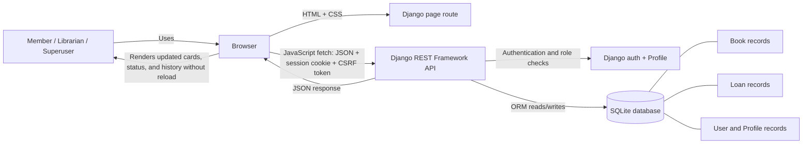
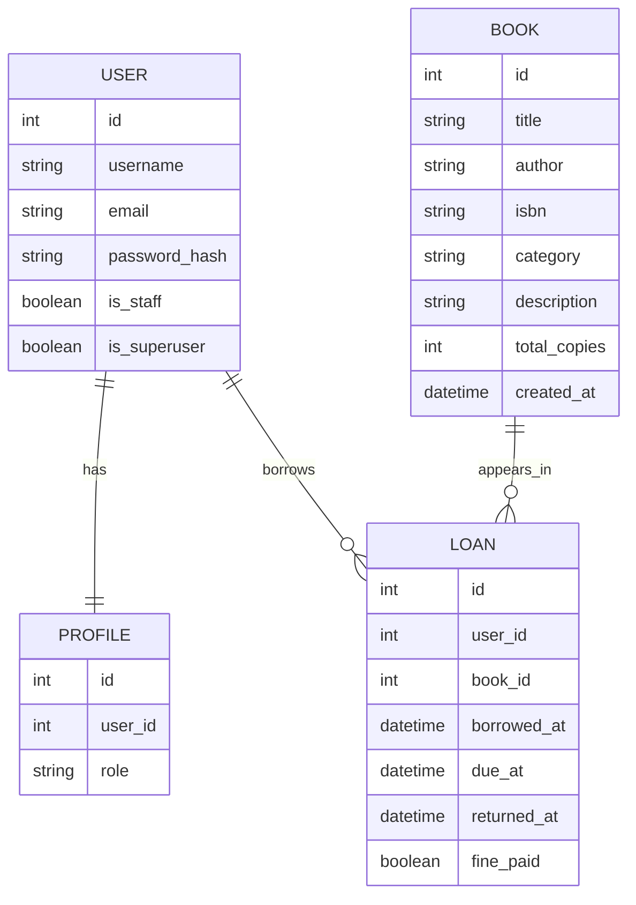
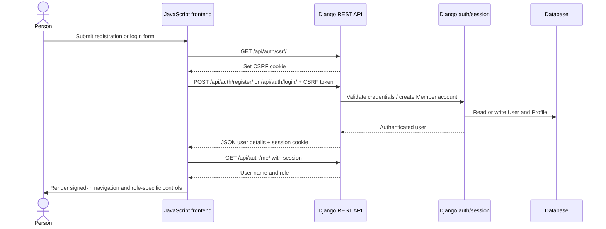
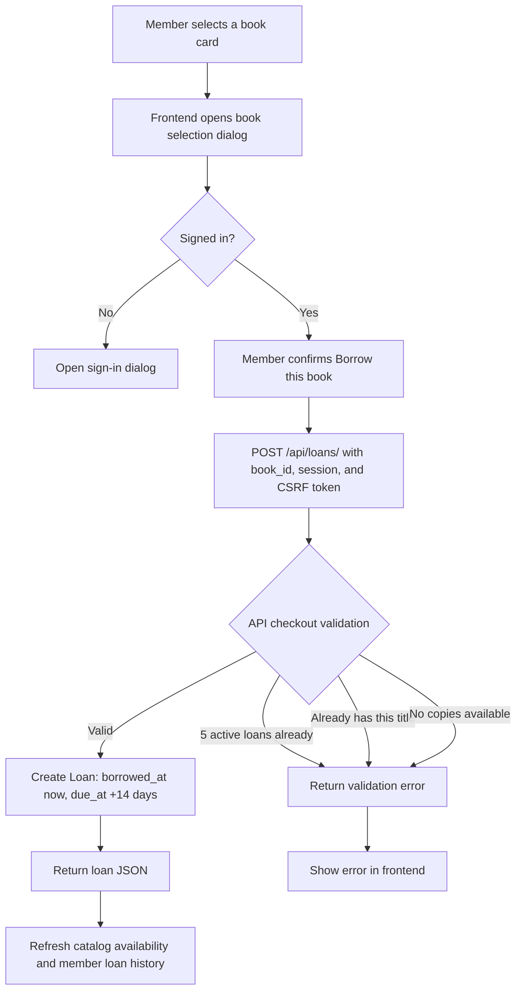
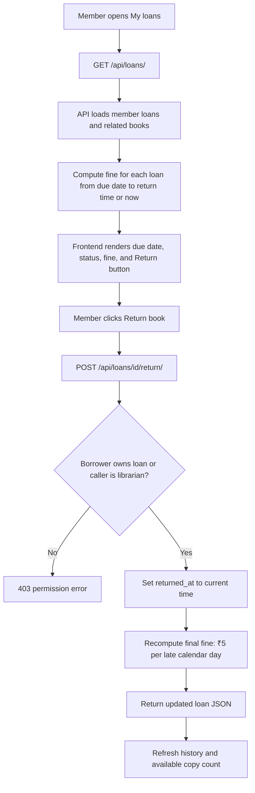
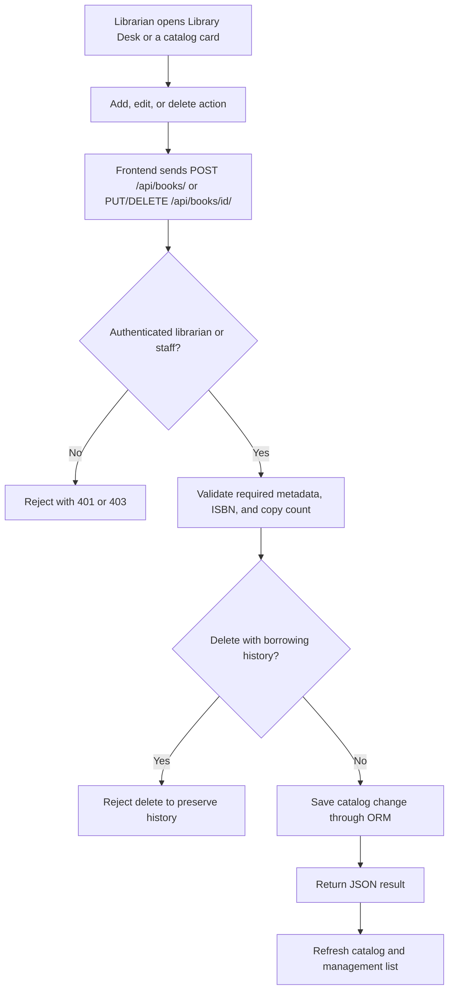

# Online Library Management System — Presentation Brief

Use this document as the source of truth when creating a PowerPoint presentation about this project. Explain both what the application does and how information moves through it. Do not describe features that are not implemented.

## Project at a glance

**Name:** Stacks — Online Library Management System  
**Purpose:** A college library web application where members discover and borrow books, and librarians maintain the catalog and review borrowing activity.  
**Architecture:** Django REST Framework backend + JavaScript single-page frontend. The browser updates the interface through asynchronous API requests without full page reloads.  
**Database:** SQLite in the local development setup.  
**Authentication:** Django user accounts and server-side session cookies; write requests include CSRF protection.

### Main user roles

- **Member:** Can register, sign in, browse and search the catalog, select a book to borrow, view loan history, and return a loan.
- **Librarian:** Can add, edit, and delete catalog books, and view loan records. Catalog changes are checked on the server.
- **Superuser:** Treated as a librarian in the interface. In addition, can check out books even when the available copy count is zero and is exempt from the member limit of five active loans and one active loan per title.

New registrations always receive the **Member** role. An existing account must be promoted by an administrator through Django admin (set Profile role to `librarian`) or marked as staff. A Django superuser is recognized as a librarian automatically.

## Features and business rules

- Catalog search matches book title, author, or ISBN; category filters narrow the list.
- Members select a catalog card and confirm **Borrow this book**. This is a library checkout flow, not a retail purchase. There are no prices, payment processing, or purchase records.
- A regular member can have at most **5 active loans**, and cannot have two active loans for the same title.
- A regular member can borrow only if at least one copy is available.
- Loan period: **14 days** from checkout.
- Late fine: **₹5 per calendar day** after the due date. Fine amount is calculated from the due date and current time (or the return timestamp) when loan data is sent by the API. It is not a payment transaction.
- Members can return their own active loans. Librarians can return any member's loan.
- Librarians can adjust total copies only if the new total is not below the number currently on loan.
- A book with any borrowing history cannot be deleted, preserving the loan history.
- The app has no fine payment workflow and no actual book purchase workflow.

## Application architecture

### Technology responsibilities

| Layer | Technology | Responsibility |
| --- | --- | --- |
| User interface | HTML, CSS, vanilla JavaScript | Catalog, search, category filters, sign-in/register dialogs, loan history, and librarian controls |
| Web framework | Django | Page delivery, sessions, CSRF middleware, user authentication, admin interface, and database integration |
| API | Django REST Framework | JSON endpoints, permissions, input validation, role enforcement, checkout/return operations |
| Data storage | SQLite by default | Users, role profiles, books, and loans |

The main page is served at `/`. Frontend code calls the API under `/api/`. A standard API write requires a valid session and CSRF token. Catalog reads are public; loan access and mutations require sign-in, with additional role or ownership checks where appropriate.

## Data model

### Entity notes

- `User` is Django's built-in authentication model. `Profile` is a one-to-one extension that stores `member` or `librarian`.
- `Book` stores the catalog metadata and total physical copies. Available copies are computed as total copies minus active loans, never below zero.
- `Loan` connects one user to one book checkout. A null `returned_at` means the loan is active. Due date is 14 days after checkout.
- Fine is computed by application logic; there is no separate fine or payment table.
- `fine_paid` exists on the loan model, but the interface currently does not provide fine payment functionality.

## Data flow: register and sign in

Registration validates the username and password, creates a Django user, creates a Member profile, then signs the new user in. Login authenticates an existing account and starts a session. The frontend uses the session cookie on subsequent API calls. Logout posts to `/api/auth/logout/` and clears the session.

## Data flow: search and browse books

1. Browser loads `/`; Django returns the page and static JavaScript/CSS.
2. JavaScript calls `GET /api/books/` and optionally sends `q` and `category` query parameters.
3. The API queries `Book` records through the Django ORM. Search covers title, author, and ISBN.
4. The API returns JSON book details, total copies, available copies, and whether the current user can borrow.
5. JavaScript renders book cards, counts, categories, and availability in place. Search and category changes fetch new JSON without reloading the page.

## Data flow: member selects and borrows a book

The endpoint validates the book exists, enforces member loan limits and availability, creates a loan, and responds with the updated loan record. The frontend then refreshes the catalog and loan list asynchronously.

### Superuser checkout exception

When the signed-in user is a Django superuser, the catalog API sets `can_borrow` true even when available copies are zero. The checkout endpoint also bypasses the regular member's five-loan limit, duplicate active-title rule, and stock-availability check. The recorded loan is still stored normally. Librarians who are not superusers follow the regular checkout rules if they borrow through the API, though the current librarian interface is primarily for catalog management.

## Data flow: return and late fine

The API prevents a member from returning someone else's loan and prevents a second return. A librarian may return a member's loan. A returned book's availability increases because the active loan no longer counts against available copies.

## Data flow: librarian catalog management

Book fields include title, author, ISBN, category, description, and total copies. ISBN is unique. A librarian cannot reduce copies below the currently active loans. A book with any loan history cannot be deleted.

## API reference for slides

| Method | Endpoint | Purpose | Access |
| --- | --- | --- | --- |
| GET | `/api/auth/csrf/` | Obtain CSRF cookie | Public |
| POST | `/api/auth/register/` | Create Member account and sign in | Public |
| POST | `/api/auth/login/` | Sign in | Public |
| POST | `/api/auth/logout/` | End session | Signed in |
| GET | `/api/auth/me/` | Get current user and role | Signed in |
| GET | `/api/books/?q=...&category=...` | Search/filter catalog | Public |
| POST | `/api/books/` | Add book | Librarian |
| GET | `/api/books/<id>/` | Read one book | Public |
| PUT, PATCH | `/api/books/<id>/` | Edit book | Librarian |
| DELETE | `/api/books/<id>/` | Delete book if no loan history | Librarian |
| GET | `/api/loans/` | Get own loan history; librarians get all loans | Signed in |
| POST | `/api/loans/` | Borrow a book using `book_id` | Signed in |
| POST | `/api/loans/<id>/return/` | Return loan | Borrower or librarian |

## Suggested PowerPoint structure

1. **Title:** Stacks — Online Library Management System; course/team/date placeholders.
2. **Problem and goal:** Campus readers need a simple way to find and borrow books; staff need a reliable catalog and borrowing record.
3. **Users and roles:** Member, Librarian, Superuser; role permissions and member-only registration.
4. **Solution overview:** Catalog, session-based sign-in, borrowing, returns, history, librarian desk, automatic fine calculation.
5. **Architecture:** Use the application architecture Mermaid flow; show browser → Django REST API → ORM → SQLite and response back to browser.
6. **Data model:** Show User/Profile, Book, and Loan entities with their relationships.
7. **Member journey:** Register/sign in → search/filter → select → confirm borrow → see loan due date.
8. **Borrowing flow and rules:** Use the checkout flowchart; call out 14 days, maximum five active loans, one copy per member/title, stock validation, superuser exception.
9. **Returns and fines:** Use the return flowchart; show ₹5 per late calendar day and explain that fines are calculated automatically, with no payment processing.
10. **Librarian workflow:** Add/edit/delete, server-side role checks, ISBN uniqueness, copy validation, preserve books with loan history.
11. **Security and reliability:** Password authentication via Django, session cookies, CSRF on writes, role/ownership checks, API-side validation.
12. **Demo/setup and future work:** Local setup with migrations and starter books; possible future work could include payments, reservations, notifications, reports, and a production database. Label these clearly as future work.

## Suggested demo sequence

1. Browse the seeded collection and search by title/author; filter by category.
2. Register a regular member and show that the role is Member.
3. Select a book, confirm checkout, then open **My loans** to show due date and loan count.
4. Sign in as librarian and demonstrate adding/editing a title. Do not delete a book with borrowing history.
5. Explain the due-date and fine calculation, then show the superuser stock/loan-limit exception.

Starter books are loaded with `python manage.py seed_books`. A staff account can be created with `python manage.py createsuperuser`. The project setup steps are in `README.md`.

## Presentation accuracy notes

- Do not claim card covers are actual scanned book covers; they are CSS-generated color treatments with title and author text.
- Do not claim users can purchase books, pay fines, reserve books, receive notifications, or use a payment gateway. Those features are not implemented.
- Describe fines as automatically calculated values. No fine settlement or payment status workflow is exposed in the interface.
- Distinguish current implementation from future ideas on the final slide.
